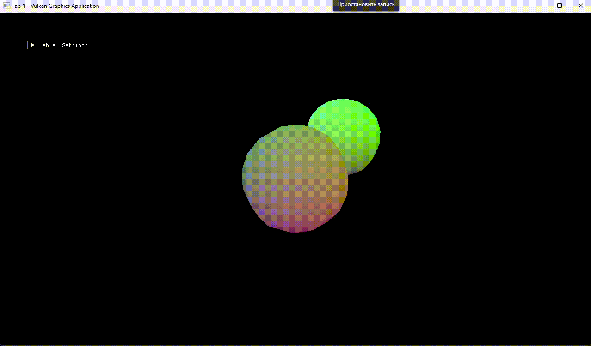
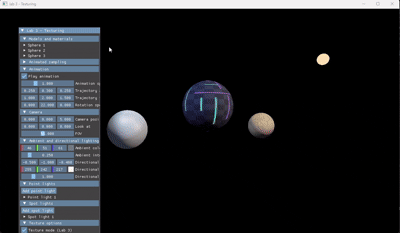

# Computer Graphics (Vulkan labs)

---
To start simulation
```bash
cd F:\CG\vulkan-starter-app\Lab_
 $env:Path = "C:\msys64\ucrt64\bin;$env:Path"
cmake --preset mingw-debug
cmake --build build-mingw-debug --parallel
.\build-mingw-debug\vulkan-starter-app.exe
```

## LAB 1
[Lab 1 Report](docs/312_Горбачев_Лаб1.docx)

Demonstration of Laboratory Work No. 1, Option 5 (Sphere with 100 Vertices)




## LAB 2
[Lab 2 Report](docs/312_Горбачев_Лаб2.docx)


## LAB 3
[Lab 3 Report](docs/312_Горбачев_Лаб3.docx)

Demonstration of Laboratory Work No. 3, Option 5 (Sphere with 100 Vertices)



## LAB 4
[Lab 4 Report](docs/312_Горбачев_Лаб4.docx)
